# Fanficly: an AO3 reader app for iPhone, iPad, Mac and Windows

Fanficly is a free, ad-free app for reading fanfiction from [Archive of Our Own (AO3)](https://archiveofourown.org) on iPhone, iPhone Duo, iPad, Mac and Windows. Its source code is public. There are no Fanficly servers or accounts, no ads and no analytics: everything runs on your device and talks directly to AO3.

<a href="https://apps.apple.com/app/id6775897153"></a> <a href="https://apps.microsoft.com/detail/9PH24K7ZCZTX"></a>

[App Store](https://apps.apple.com/app/id6775897153) (iPhone, iPhone Duo, iPad and Mac) · [Microsoft Store](https://apps.microsoft.com/detail/9PH24K7ZCZTX) (Windows) · [fanficly.app](https://fanficly.app)

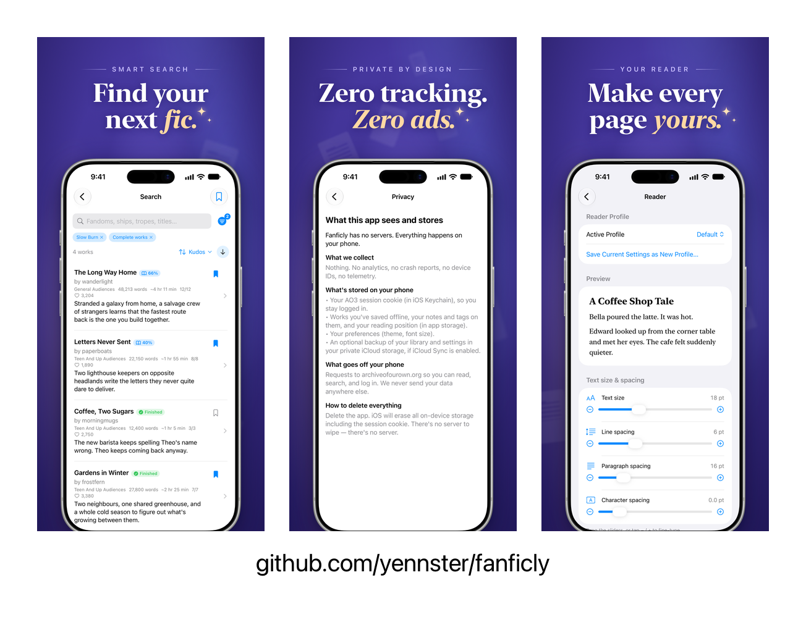

## What it does

- **Search that does what you typed.** Keywords go to AO3's own search, and live tag suggestions turn words into exact filters with one tap. `teen wolf` means Teen Wolf.
- **A reader made for long stories.** Scroll, swipe by chapter or turn pages like a book, with two-page spreads on wide screens, themes, fonts and named typography profiles.
- **Your library, offline.** Save stories, read them without a connection, sort them into folders, and pick up at the exact paragraph you left.
- **New chapter alerts.** Follow works and authors without an account and get a notification when something new is posted.
- **Listen.** Stories read aloud with the device's own voices, nothing sent anywhere.
- **Stats and a yearly wrap.** Stories finished, time and words read, your streak and your top fandoms, all computed on your device.
- **Optional AO3 account.** Sign in for your AO3 subscriptions, bookmarks, comments and kudos. Your password is never stored.

## Pick your platform

Every app has the same core features. Open a platform for its screenshots, extras and docs. The iPhone, iPhone Duo, iPad and Mac sections share one guide: [features](apple/README.md#features) · [build and run](apple/README.md#development) · [accessibility](apple/ACCESSIBILITY.md) · [roadmap](apple/docs/ROADMAP.md) · [privacy](PRIVACY.md).

<details>
<summary><b>iPhone</b>: the SwiftUI app, iOS 17 and later</summary>
<br>

| Search | Reader | Library | Browse |
| :---: | :---: | :---: | :---: |
| 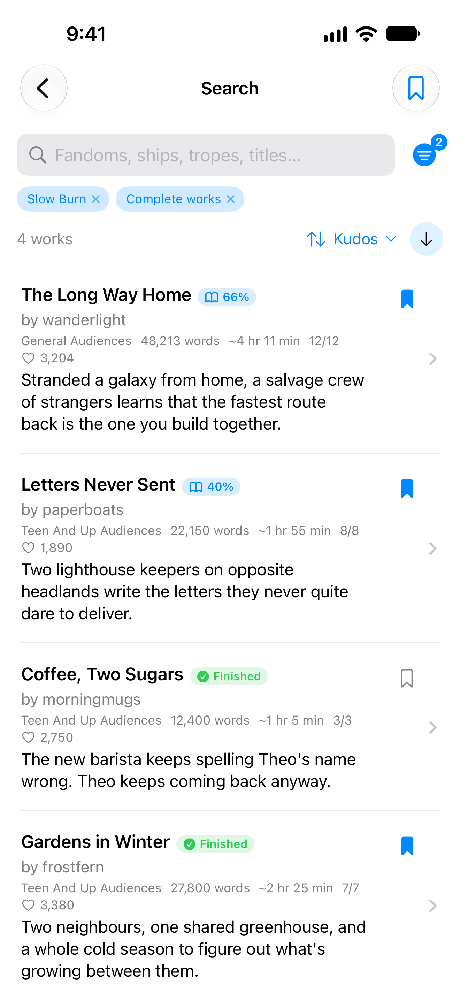 | 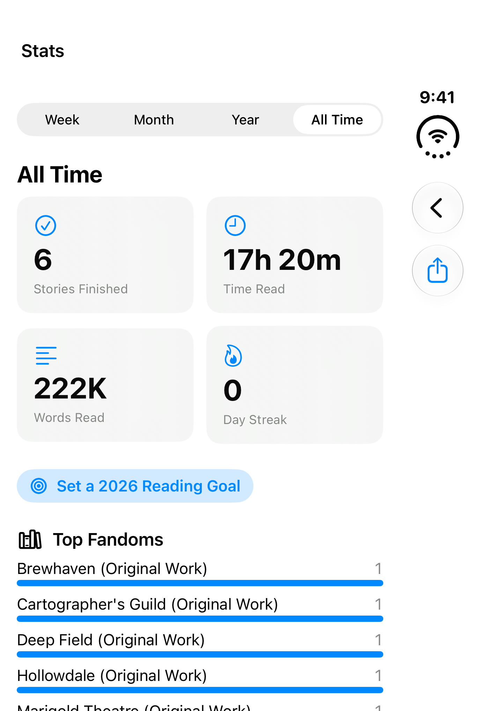 | 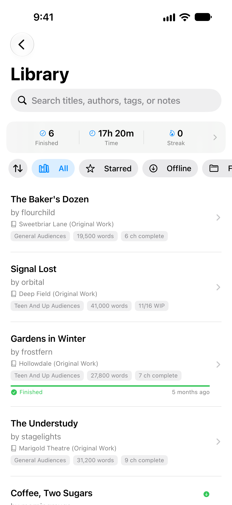 | 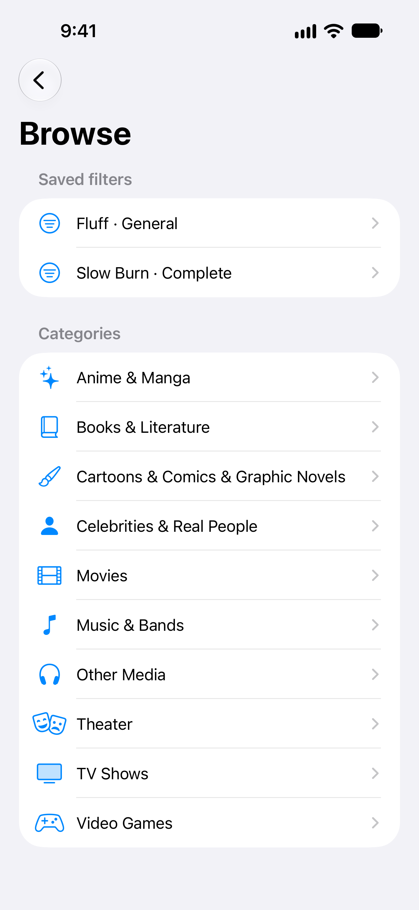 |

Home-screen and lock-screen widgets, the Safari share sheet, and lock-screen controls while a story is read aloud.

**Docs:** [the Apple app guide](apple/README.md) · [all iPhone screenshots](apple/docs/screenshots/iphone/)

</details>

<details>
<summary><b>iPhone Duo</b>: the same app, folded and unfolded</summary>
<br>

| Folded: search | Folded: reader | Folded: library |
| :---: | :---: | :---: |
| 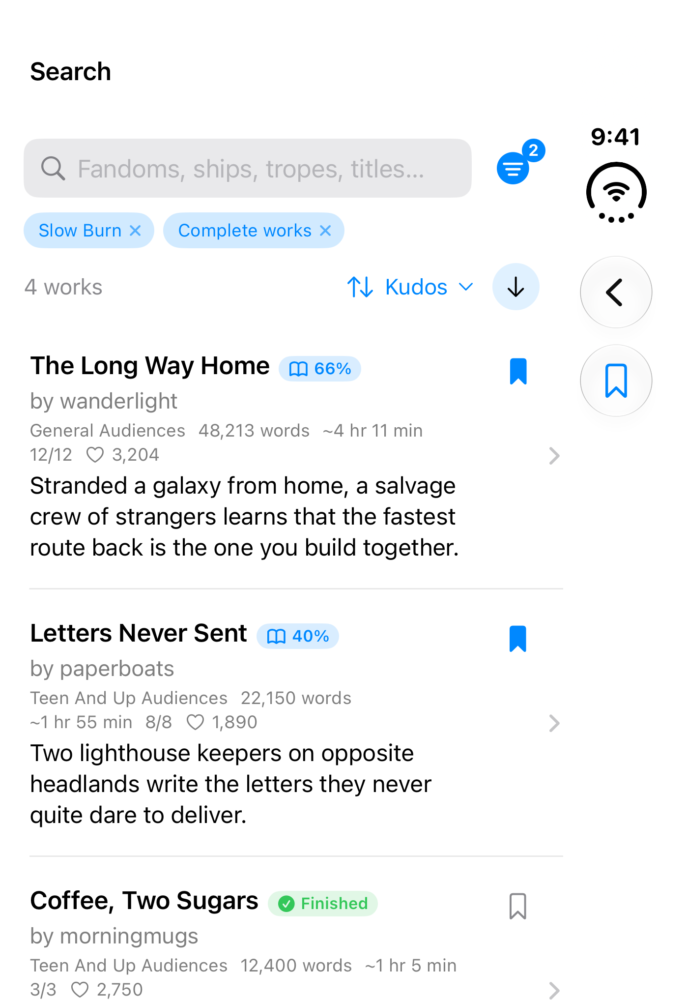 | 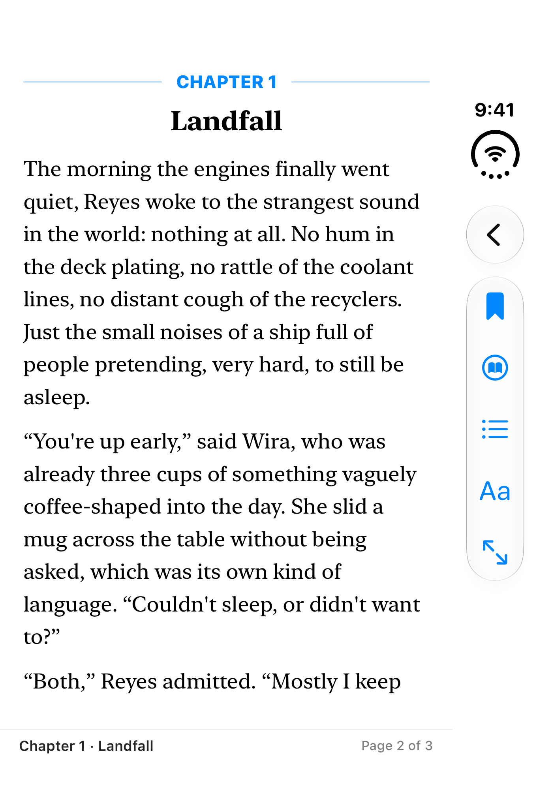 | 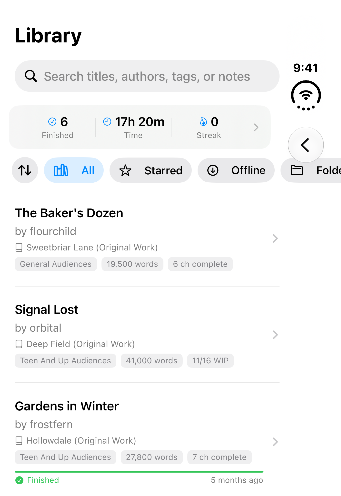 |

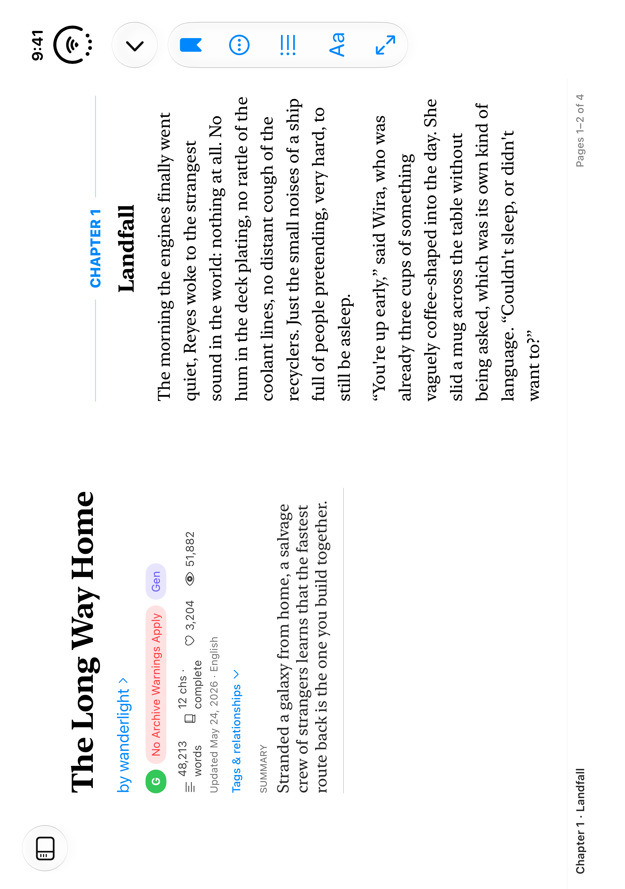

Unfolded, the reader becomes an open book with the fold as its spine. Folding or unfolding keeps your place in the story.

**Docs:** [the Apple app guide](apple/README.md) · screenshots: [folded](apple/docs/screenshots/duo-outer/), [unfolded](apple/docs/screenshots/duo-inner/)

</details>

<details>
<summary><b>iPad</b>: sidebar layout and Split View</summary>
<br>

| Search | Reader | Library | Browse |
| :---: | :---: | :---: | :---: |
|  | 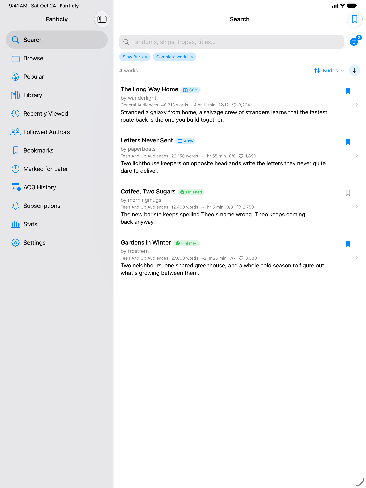 | 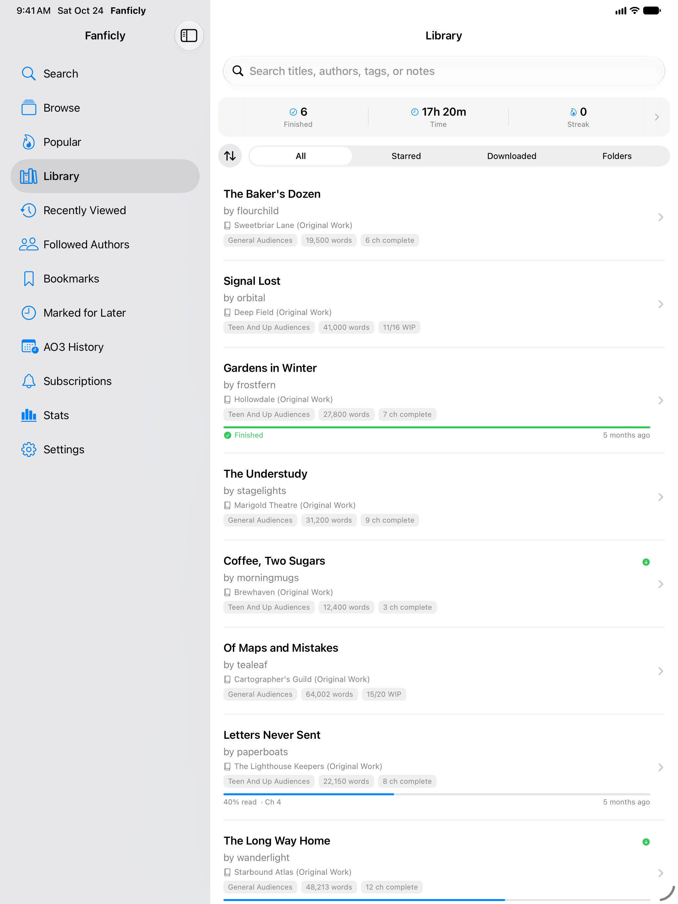 | 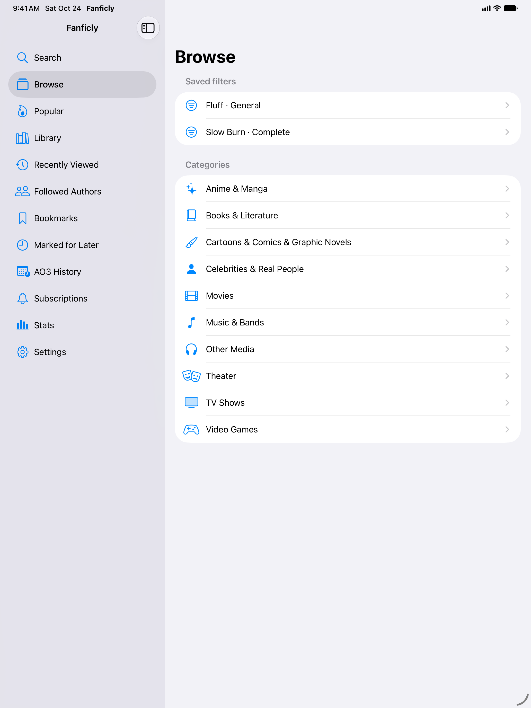 |

A sidebar beside every screen, two-page spreads in landscape, and page turns from a hardware keyboard or a Bluetooth page turner.

**Docs:** [the Apple app guide](apple/README.md) · [all iPad screenshots](apple/docs/screenshots/ipad/)

</details>

<details>
<summary><b>Mac</b>: the same app through Mac Catalyst</summary>
<br>

| Search | Reader settings |
| :---: | :---: |
| 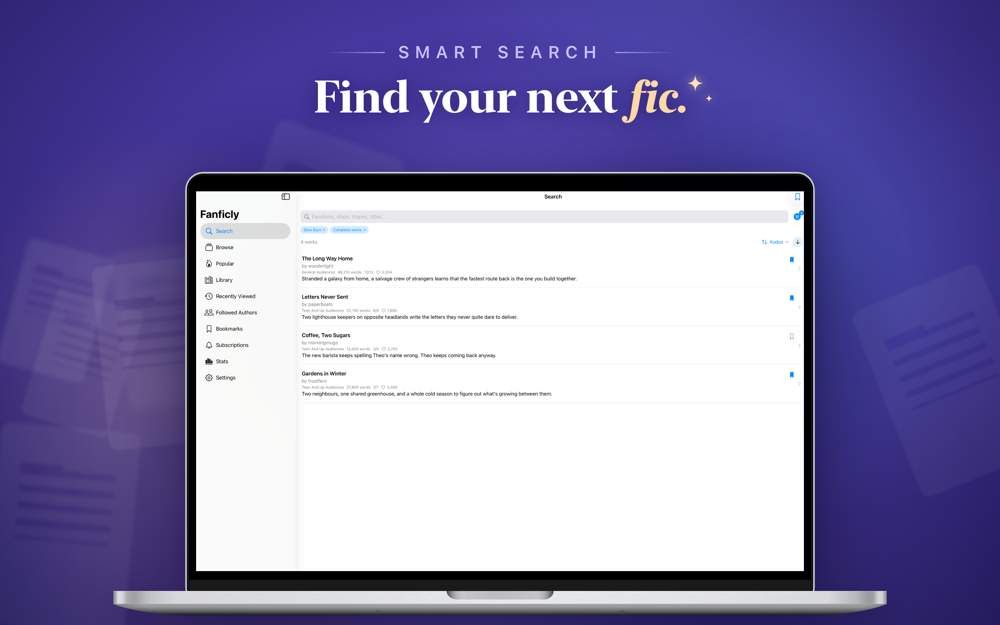 |  |

A resizable window, ⌘1–9 for the tabs, interface zoom from the View menu (⇧⌘+ / ⇧⌘− or ⌘+ / ⌘−, ⌘0), and arrow keys, Page Up / Page Down or a Bluetooth page turner to turn pages.

**Docs:** [the Apple app guide](apple/README.md) · [all Mac screenshots](apple/screenshots/final/mac/)

</details>

<details>
<summary><b>Windows</b>: WinUI 3, Windows 10 and 11, x64 and ARM64</summary>
<br>


Widgets on Windows 11, taskbar jump lists, sync through OneDrive or any folder you already sync, keyboard, controller and Narrator support. The backup format matches the Apple app, so a PC and an iPhone can share one library.

**Docs:** [features and setup](windows/README.md) · [build and run](windows/README.md#development) · [accessibility](windows/ACCESSIBILITY.md) · [roadmap](windows/ROADMAP.md) · [privacy](windows/PRIVACY.md) · screenshots: [desktop](windows/docs/screenshots/desktop/), [tablet](windows/docs/screenshots/tablet/), [narrow window](windows/docs/screenshots/compact/)

</details>

The screenshots come from each app's demo mode and are regenerated by the release tooling, so they track what shipped.

## For developers

| App | Folder | Built with | Developer docs |
| --- | --- | --- | --- |
| iPhone, iPhone Duo, iPad and Mac | [`apple/`](apple/) | SwiftUI, Swift 6 (Mac via Catalyst) | [README](apple/README.md#development) · [contributing](apple/CONTRIBUTING.md) · [releasing](apple/docs/RELEASING.md) |
| Windows | [`windows/`](windows/) | C#, .NET 10, WinUI 3, Native AOT | [README](windows/README.md#development) · [contributing](windows/CONTRIBUTING.md) · [Store](windows/MICROSOFT_STORE.md) |

The two apps share behavior, not code: the Windows app is a port of the Swift app, which stays the reference implementation. Both are developed on `main`.

<details>
<summary>Repository layout</summary>

```text
apple/        the iPhone, iPad and Mac app (Xcode project from project.yml)
windows/      the Windows app (Fanficly.Windows.slnx)
website/      fanficly.app (static site, deployed by Vercel)
CITATION.cff  machine-readable summary of the app (GitHub's "Cite this repository")
.github/      CI: ci.yml for apple/, windows-*.yml for windows/; release.yml and
              store-assets.yml release the Apple app (apple/docs/RELEASING.md);
              scripts/roadmap.sh lists both roadmaps
```

CI is split by app: a change under `apple/` runs the Apple workflow, a change under `windows/` runs the Windows ones, and a pull request that touches both runs both.

</details>

## FAQ

### What is Fanficly?

Fanficly is an app for reading fanfiction from Archive of Our Own (AO3). It searches AO3 with live tag suggestions and every AO3 filter, keeps a library you can read offline, remembers your place in each story down to the paragraph, and reads stories aloud with your device's own voices.

### Is Fanficly free?

Yes. Fanficly is free on the [App Store](https://apps.apple.com/app/id6775897153) and the [Microsoft Store](https://apps.microsoft.com/detail/9PH24K7ZCZTX), and it has no ads.

### Which devices does Fanficly run on?

iPhone and iPad with iOS 17 or later (including iPhone Duo, folded and unfolded), Macs with macOS 14 Sonoma or later, and PCs with Windows 10 (version 2004 or later) or Windows 11, on x64 and ARM64.

### Does Fanficly work with Bluetooth page turners?

Yes. Page turners and scroll remotes that pair as a Bluetooth keyboard (arrow keys, Page Up and Page Down, or Space) turn the page in page-by-page mode and scroll a screenful in the scrolling modes, on iPhone, iPad, Mac and Windows. Ring and handheld scrollers that pair as a mouse or touch device swipe and tap like a finger. Remotes that only send volume or camera-shutter presses aren't supported, so switch the remote to its page-turn or keyboard mode.

### Do I need an AO3 account?

No. Searching, reading, saving works for offline reading, and following works and authors all work without an account. Signing in to AO3 is optional and adds your AO3 bookmarks, subscriptions, comments and kudos. Your password goes only to AO3 and is never stored.

### Can I read AO3 fanfiction offline?

Yes. Download a work and its chapters are saved on your device. You can also export a work as EPUB, MOBI, AZW3, PDF or HTML.

### Will Fanficly tell me when a story updates?

Yes. Follow a work or an author and Fanficly checks in the background, then sends a notification when a new chapter or a new work is posted. This needs no account.

### Does Fanficly collect my data?

No. There is no Fanficly account or server, no analytics, no ads and no tracking. Your library, reading progress and settings stay on your devices. On Apple devices, reader profiles and your last-read position sync through your own iCloud, and you can turn on a full library backup there too. On Windows, sync is off until you pick a folder, such as OneDrive or any folder you already sync.

### How does Fanficly get stories from AO3?

AO3 has no public API, so Fanficly reads the same web pages the AO3 website serves, at most one request a second, with a User-Agent that names the app and links to this repository.

### Is Fanficly affiliated with AO3?

No. Fanficly is an independent app, not affiliated with, endorsed by or sponsored by AO3 or the Organization for Transformative Works. Every work is hosted and moderated by AO3.

### Is Fanficly's source code available?

Yes. The source code for every app is public in this repository under the [PolyForm Noncommercial License 1.0.0](LICENSE), which allows reading, changing and sharing it for any noncommercial purpose.

## Privacy

We collect nothing. Each store listing links its own policy: [PRIVACY.md](PRIVACY.md) for iPhone, iPad and Mac, and [windows/PRIVACY.md](windows/PRIVACY.md) for Windows.

## Contributing

PRs welcome. Read [CONTRIBUTING.md](CONTRIBUTING.md), then the guide for the app you're changing. Be kind, be patient with reviewers. See [CODE_OF_CONDUCT.md](CODE_OF_CONDUCT.md).

Fanficly is not affiliated with AO3 or the Organization for Transformative Works.

## License

[PolyForm Noncommercial License 1.0.0](LICENSE).
