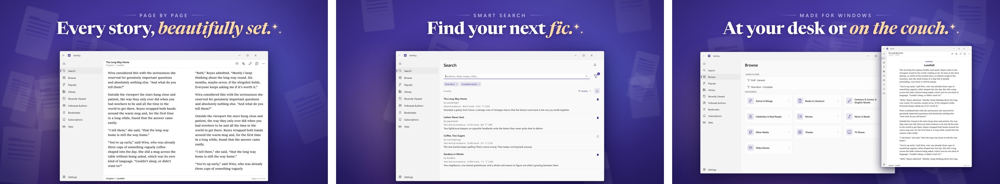
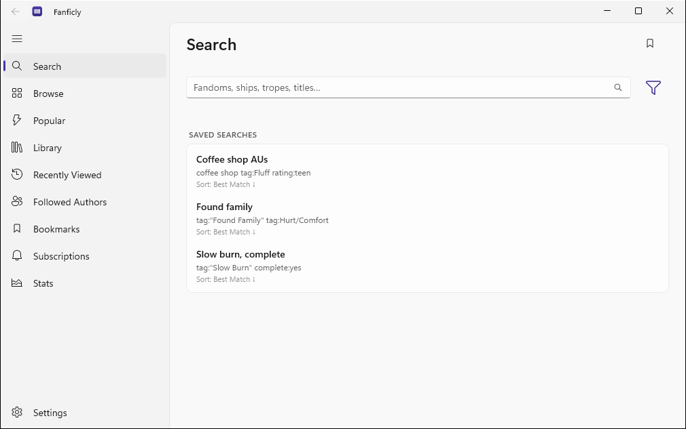
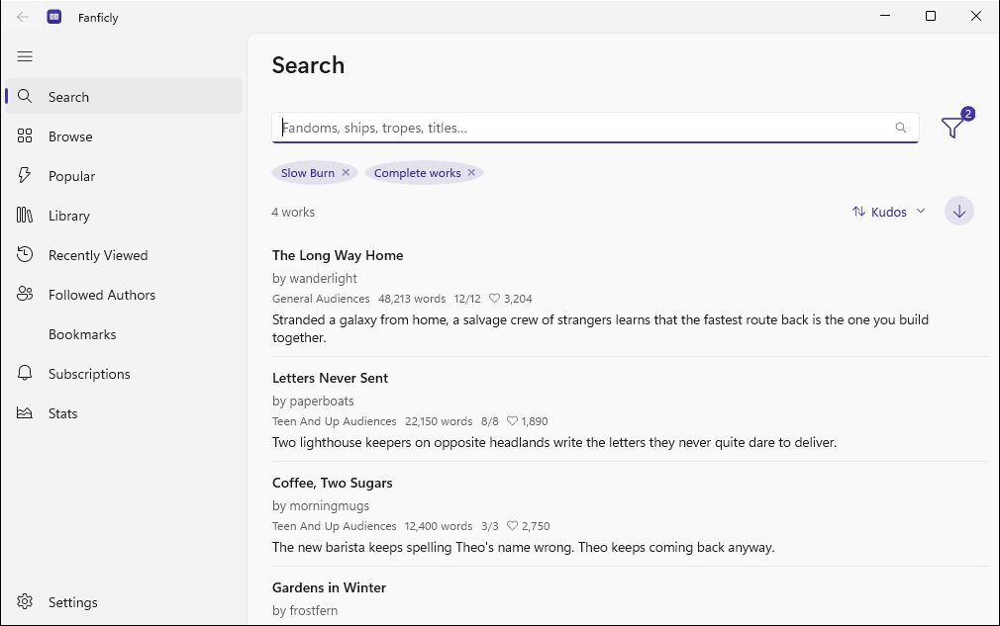
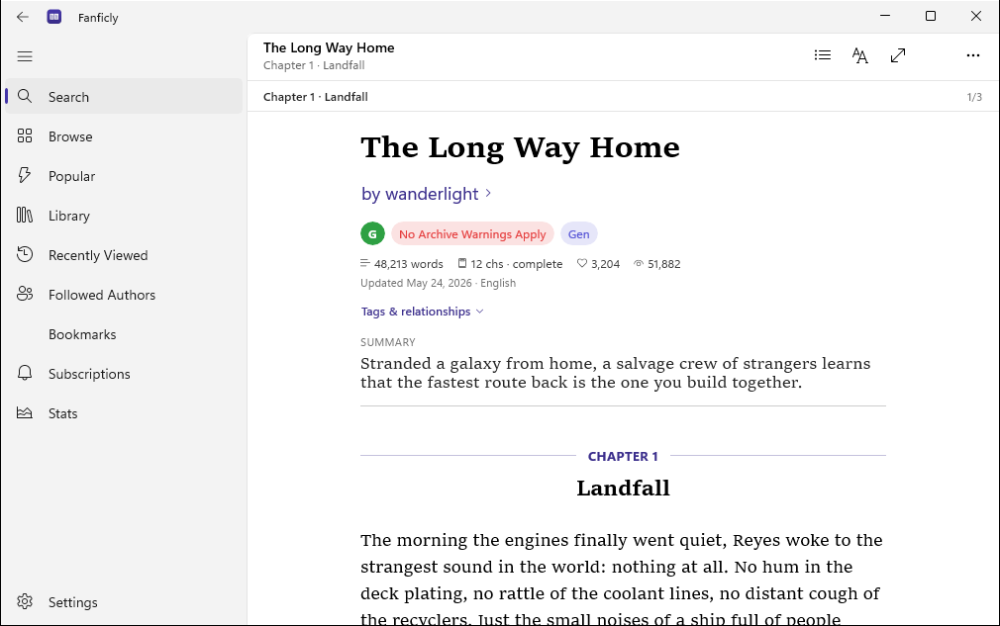
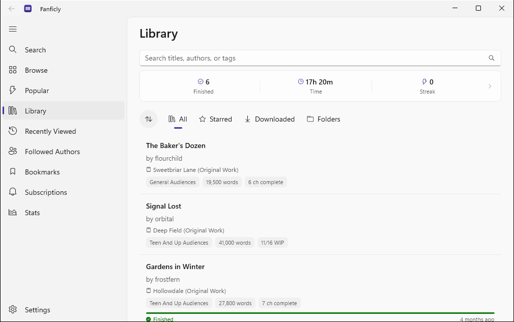

# Fanficly for Windows

An open-source, ad-free Windows reader for [Archive of Our Own](https://archiveofourown.org).



This is the `windows` branch: a native Windows app in C# on .NET 10 with WinUI 3 (Windows App SDK), compiled with Native AOT and shipped through the Microsoft Store as an MSIX bundle for x64 and ARM64. It runs on Windows 10 (version 2004, build 19041, and later) and Windows 11. The app lives in [`windows/`](windows/).

The iPhone, iPad and Mac app is on the [`main`](https://github.com/yennster/fanficly/tree/main) branch. Its Swift sources (`Fanficly/`, `FanficlyWidget/`, `FanficlyShare/`, the Xcode project) are still in this branch as the reference implementation the Windows port follows, but nothing here builds or ships them.

| Home | Search results |
| --- | --- |
|  |  |
| **Reader** | **Library** |
|  |  |

The same screens at a tablet size and in a narrow window are in [`docs/screenshots/windows/tablet/`](docs/screenshots/windows/tablet/) and [`docs/screenshots/windows/compact/`](docs/screenshots/windows/compact/): `01-home`, `02-search-results`, `03-reader`, `04-library`, `05-browse`, `05-browse-fandoms`, `06-recently-viewed`, `07-reader-settings`, `08-privacy`, `09-tts`, `10-popular`, `11-comments`, `12-bookmarks` and (desktop and tablet) `13-reader-spread`, the reader page by page.

_The screenshots come from the UI tests: `windows/tests/Fanficly.UITests/ScreenshotTests.cs` launches the app in demo mode (offline, all-ages sample content) and photographs each screen at a desktop (1600 × 1000), tablet (834 × 1112) and compact (420 × 880) window size. To regenerate them, see [Screenshots](#screenshots) below._

## Features

- **Search that does what you typed.** Keywords go straight to AO3's own search. As you type, live suggestions from AO3's tag list (fandoms, ships, characters, tropes) turn the words you're typing into exact tag filters with one click. Typing `complete`, `wip`, `explicit`, `m/m`, `under 10k` or `in spanish` makes a filter chip; everything else stays a keyword, so `teen wolf` means Teen Wolf. A Filters panel covers ratings, warnings, categories, length, language and sort, and `title:`, `by:`, `tag:"…"` and `-tag:"…"` give precise control. Recent and saved searches are one click away, and Search tips explains it all. Ctrl+F or F3 jumps back to the search box.
- **Browse by fandom, with AO3's full filter set.** All 10 AO3 media categories, each loading the complete live fandom list with work counts and instant search (and a curated list when AO3 can't be reached). A fandom's works filter exactly like on AO3: rating, warnings, category, completion, crossovers, word count, and relationships, characters and tags to include or exclude. Typed tags resolve to AO3's canonical names through its autocomplete, so `Hermione/Draco` finds `Hermione Granger/Draco Malfoy`. Save a filter once and run it from the Browse home.
- **Popular.** Popular fandoms, ships and characters, ranked from AO3's work counts (refreshed at most once a day, in the background), with a curated list whenever AO3 can't be reached. Pick one to see its works sorted by kudos.
- **Library.** Every saved story, filtered by All, Starred, Downloaded or Folders, searchable by title, author or tag, and sorted by date saved, last read, last updated, title, author or length (pinned stories stay on top). Every started story shows a reading-progress bar and a "Finished" badge when you're done. Right-click (or Shift+F10) a story to star, pin, file it in folders, download it for offline reading, share it or delete it. Custom folders have their own sorted, searchable lists. Keys: Enter opens, Delete removes, F2 renames a folder, Ctrl+Shift+N makes one.
- **Follow, star and pin.** Save any story with one click, right from the results list. Followed works are checked for new chapters in the background, and a Windows notification tells you when one is posted. Click the notification to open the story, even when it starts the app.
- **Follow authors.** Follow an author from their works page and get a notification when they post a new work. The Authors tab keeps everyone you follow in one place.
- **Recently Viewed.** The stories you've opened, newest first. Remove one with Delete, several with Edit, or clear the list.
- **Comments.** Read a chapter's comment thread, with replies indented under the comment they answer. Signed in to AO3, post a comment of your own.
- **AO3 account (optional).** Sign in to see your AO3 subscriptions (synced into the Subscriptions tab with your local follows), browse your AO3 bookmarks (private ones included) and post comments. Your password goes only to AO3 and is never stored; the session cookie is kept encrypted with Windows Data Protection, so only your Windows account can read it.
- **Reading stats and a yearly wrap-up.** The Stats tab totals the stories you've finished, time read, words read and your day streak, with top fandoms, ships, categories and authors for any week, month, year or all time. Share the wrap-up card, save it as an image or copy it. Everything is computed on your PC.
- **Widgets.** Six widgets for the Windows 11 Widgets board, each small or medium: Continue reading (your last story and how far you got), Reading Streak, Subscriptions, Folder Shortcuts, Saved Searches and Recommendation. Clicking one opens the story, folder or search it shows.
- **Jump list.** Right-click Fanficly on the taskbar or in Start for "Continue" with your last story, and shortcuts to Search, Library, Popular and Subscriptions.
- **Share → Fanficly, drop or paste.** Share an AO3 work page from Edge, Chrome or any app that shares links, drag a work link onto Fanficly's window, or copy one and press Ctrl+V (outside a text box), and Fanficly fetches the work, saves it to your Library, downloads it for offline reading and opens it.
- **`fanficly://` links.** `fanficly://resume/<id>?chapter=<n>&paragraph=<m>`, `fanficly://import?url=<AO3 link>`, `fanficly://library?folder=<name>` and `fanficly://search?query=<text>`. Fanficly is single-instance: a second launch (a link, a notification, a widget, a jump-list entry) hands its request to the window that's already open.
- **Sync across devices, through a folder you already sync.** Fanficly has no servers, so it syncs through a folder you pick: OneDrive (the default), Google Drive, Dropbox, Box, iCloud Drive (with iCloud for Windows) or any other. Settings → Sync lists the ones installed on the PC. Your library (saved works, downloaded chapter text, folders, reading positions, stats, saved searches and filters, and each device's reader settings) and your reader profiles, last-read story and streak are written there, and that service carries them to your other devices. The backup is the Apple app's format exactly, so a PC and an iPhone, iPad or Mac pointed at the same backup share one library. Backups merge with what's already there and restores only ever move things forward, so a device with less can never erase another's.
- **Content and safety.** A 17+ confirmation on first launch, a "Filter mature & explicit works" switch (on by default), and a list of works you've hidden from results.
- **Made for Windows.** A Windows 11 title bar and Mica backdrop (acrylic where Mica isn't available), the sidebar folding to icons and then to a menu button as the window narrows, light, dark or system app theme, and high-contrast themes. Keyboard: Ctrl+1…9 for the tabs and Ctrl+, for Settings, Ctrl+Plus / Ctrl+Minus / Ctrl+0 to zoom the whole interface, F11 for full screen, Alt+Left, Esc or the mouse's back button to go back; Settings → Keyboard shortcuts lists them all. Xbox and other XInput controllers work too (D-pad to move, A to select, B to go back, LB / RB to switch tabs). Narrator reads every control, and the app announces what changes on screen.
- **Zero tracking.** No analytics, no crash reporters, no telemetry, no ads.

### The reader

- **Three reading modes.** Continuous scroll, swipe by chapter (one chapter per page, scrolling inside it), or page by page. In a window at least 700 pixels wide and clearly wider than tall (maximized, full screen, a tablet in landscape), page by page pairs pages into a two-page spread like an open book ("Pages on screen": one or two), with its own margins setting. Pages always fill the window to their last line, and resizing the window, changing the text or hiding the controls keeps the first words of the page you're on in place.
- **Turning pages, your way.** In page by page, Left / Right, Page Up / Page Down and Space (Shift+Space back) turn pages; in the scrolling modes they move a screenful, and Left / Right change chapter in swipe by chapter. Ctrl+Left / Ctrl+Right jump a chapter, and Home / End go to the start or end of the chapter. Click or tap the outer third of a page, swipe, flick a pen or turn the mouse wheel. Tapping the middle of the page hides or shows the reader's controls. On a controller, the triggers and D-pad turn pages and the bumpers change chapter. F11 or the full-screen button hides the sidebar, title bar and controls; Esc brings them back.
- **Typography.** Six themes (Match System, Light, Sepia, Dark, OLED Black, Dracula Navy), five font families (mapped to the closest fonts Windows ships: Sitka Text, Georgia, Segoe UI Variable, Arial Rounded where Office installed it, and Cascadia Mono), bold text, and text size, line spacing, paragraph spacing, character spacing and margins, as presets in the reader's Aa menu or as continuous sliders with a live preview in Settings → Theme & typography. Zooming the interface with Ctrl+Plus / Ctrl+Minus leaves the story's text size alone.
- **Reader profiles.** Save complete typography setups as named profiles and switch, rename or delete them from the Aa menu or Settings. They sync through your sync folder, deleting one sticks across devices, and each device (iPhone, iPad, Mac, Windows) keeps its own active profile and settings.
- **Listen.** Any chapter read aloud with the voices built into Windows, entirely on your PC (Listen in the Aa menu, or Ctrl+L). The spoken paragraph is highlighted and kept in view, a bar at the bottom has play / pause, previous and next paragraph, a chapter picker and a speed from 0.5× to 2×, and narration moves on to the next chapter by itself. Your keyboard's media keys, headset buttons and Windows' media flyout control it too. Voice and default speaking rate are in Settings → Theme & typography, with a spoken sample.
- **Story images (opt-in).** "Show images in stories" (off by default) shows authors' embedded artwork inline, in fixed-height slots so a slow image can never move your place. Images load from the author's image host when you read and are never saved with a download.
- **Resume where you left off.** Your position is saved down to the paragraph and restored when you reopen a story, in any reading mode. Reading to the last line counts as finished. The Continue reading widget and the jump list's "Continue" open the story where you were, and never move your saved place backwards.
- **Work page.** Full work metadata (rating, warnings, categories and stats, with fandoms, relationships, characters and tags behind "Tags & relationships"; each tag opens its works), the author's byline opening their works, a Save to Library button, and an options menu for comments, share and export, downloading for offline reading, subscribing on AO3 (signed in), reporting the work to AO3 and hiding it.
- **Export in any format.** Share the work as EPUB, MOBI, AZW3, PDF or HTML through Windows' Share sheet, or save a copy anywhere with "Save a copy as".
- **Keep screen awake** while reading (on by default in Settings).

## Tech

- C# on .NET 10 (the SDK version is pinned in [`windows/global.json`](windows/global.json)), with nullable reference types on.
- WinUI 3 through the [Windows App SDK](https://github.com/microsoft/WindowsAppSDK). The UI is built in C#, not XAML markup, so the whole app compiles and type-checks on any OS.
- Native AOT in Release builds: machine code, no JIT, fast cold start. The code avoids reflection-based JSON and other trimming hazards.
- MSIX packaging: one Store bundle with x64 and ARM64.
- [AngleSharp](https://anglesharp.github.io/) parses AO3's HTML; [Microsoft.Data.Sqlite](https://learn.microsoft.com/dotnet/standard/data/sqlite/) holds the library database.
- [xUnit](https://xunit.net/) for unit tests, [FlaUI](https://github.com/FlaUI/FlaUI) for UI automation tests.
- Package versions are pinned centrally in [`windows/Directory.Packages.props`](windows/Directory.Packages.props). There are no other dependencies.

The solution is [`windows/Fanficly.Windows.slnx`](windows/Fanficly.Windows.slnx):

| Project | What it is |
| --- | --- |
| `src/Fanficly.Core` | Everything that isn't UI, platform-neutral (`net10.0`): the AO3 client and HTML parsers, search syntax, the library database, sync merging, stats, widgets' data, and the reader's layout logic. |
| `src/Fanficly.App` | The WinUI app (`Fanficly.exe`): the window, the screens, and the Windows integrations (notifications, widgets, the background task, the jump list, the Share target, controllers). |
| `tests/Fanficly.Core.Tests` | Unit tests for Core. Fixture-based, no network; they run on Windows, Linux and macOS. |
| `tests/Fanficly.UITests` | UI automation tests that drive the built app in demo mode. Windows only. |

## Development

You need the .NET 10 SDK. Everything below runs from the `windows/` folder.

### Build and test on any OS

```bash
cd windows
dotnet test tests/Fanficly.Core.Tests          # the unit tests
dotnet build src/Fanficly.App -p:Platform=x64  # compiles the app (Platform=ARM64 for Arm)
```

The app compiles on Linux and macOS too (`EnableWindowsTargeting` in `Directory.Build.props`), so you can check a change there. Packaging (MakePri and MSIX) is switched off off Windows, and running the app or its UI tests needs Windows.

### Run it on Windows

Build an unpackaged, self-contained copy and start it:

```powershell
cd windows
dotnet build src/Fanficly.App -c Debug -p:Platform=x64 -p:WindowsPackageType=None `
  -p:WindowsAppSDKSelfContained=true -p:RuntimeIdentifier=win-x64 -o ../artifacts/app-x64
../artifacts/app-x64/Fanficly.exe -demoMode
```

- `-demoMode` runs fully offline with a curated, all-ages demo catalogue and in-memory storage, so nothing on your PC changes. It's what the UI tests and screenshots use.
- Without it, the app talks to AO3 and keeps its data in `%LOCALAPPDATA%\Fanficly` (an installed MSIX uses its own package folder instead).
- `-tab <name>` opens a tab at launch (`search`, `browse`, `popular`, `library`, `recentlyViewed`, `authors`, `bookmarks`, `subscriptions`, `stats`, `settings`).
- With `-demoMode`, `-set key=value` presets a setting for that run (for example `-set reader.mode.windows=pageByPage`), and `-demoLongChapters` makes the demo chapters long enough for full pages mid-chapter. The UI tests use both.
- `-iconGallery` opens a page showing every icon the app uses, to spot one missing from the installed icon font.

Some integrations come from the MSIX manifest (`windows/src/Fanficly.App/Package.appxmanifest`) and need package identity, so they only work from an installed package: the Widgets board, the background refresh task, the Share target, the `fanficly://` protocol and the Store rating dialog. Visual Studio (with the WinUI application development workload) can deploy the packaged app for debugging.

### The Store package

CI builds the Store upload with MSBuild on Windows, in Release (Native AOT), for both architectures at once:

```powershell
cd windows
msbuild src/Fanficly.App/Fanficly.App.csproj /t:Restore /p:Configuration=Release
msbuild src/Fanficly.App/Fanficly.App.csproj /p:Configuration=Release /p:Platform=x64 `
  /p:AppxBundle=Always "/p:AppxBundlePlatforms=x64|arm64" /p:UapAppxPackageBuildMode=StoreUpload `
  "/p:AppxPackageDir=$PWD\..\artifacts\AppPackages\" /p:GenerateAppxPackageOnBuild=true /p:AppxPackageSigningEnabled=false
```

That needs Visual Studio's MSBuild with the **WinUI application development** and **Desktop development with C++** workloads (the C++ tools are needed for Native AOT). Publishing to the Microsoft Store, the listing text in `windows/store/`, versioning and release tags are in [MICROSOFT_STORE.md](MICROSOFT_STORE.md).

### UI tests

`tests/Fanficly.UITests` launches the built app in demo mode and drives it through UI Automation. `SmokeTests` check that every tab opens from its shortcut in a laptop-sized and a narrow window, the sidebar works, back returns to the tab's root, zoom and full-screen keys, a second launch is handed to the running window, and a `fanficly://search` link opens Search. `ReaderLayoutTests` open a long demo story in page by page and check what's drawn: the page footer sits on the bottom edge, each page's text ends just above it and never under it, minimizing the window, a dialog and hiding the controls leave the page in place (and hiding them fills the freed room with text), and a wider window shows a two-page spread exactly when the spread rule says so.

```powershell
cd windows
dotnet build tests/Fanficly.UITests
dotnet test tests/Fanficly.UITests --no-build --filter "FullyQualifiedName~SmokeTests"
dotnet test tests/Fanficly.UITests --no-build --filter "FullyQualifiedName~ReaderLayoutTests"
```

The tests use the app at `windows/artifacts/app-x64/Fanficly.exe` (the build above), or the one named by the `FANFICLY_EXE` environment variable. They move and click the real window, so leave the mouse and keyboard alone while they run.

### Screenshots

`ScreenshotTests` walks the demo app through the same screens as the Apple app's screenshot tests and saves each one at the desktop, tablet and compact sizes. It writes to the folder in `FANFICLY_SCREENSHOTS`, one subfolder per size. To capture them on your own PC, straight into this README's folder:

```powershell
cd windows
$env:FANFICLY_SCREENSHOTS = (Resolve-Path ../docs/screenshots/windows).Path   # create the folder first
dotnet test tests/Fanficly.UITests --no-build --filter "FullyQualifiedName~ScreenshotTests"
```

The test fails if any screen couldn't be reached, so a stale picture can't slip through. CI runs it on every push to `windows` and uploads the pictures as the `ui-screenshots` artifact, along with an `icons/` gallery (from `-iconGallery`) and the reader layout tests' `reader-layout/` steps.

The usual way to refresh the committed pictures is the **Windows screenshots** workflow ([`.github/workflows/windows-screenshots.yml`](.github/workflows/windows-screenshots.yml)): push a commit to `windows` with `[screenshots]` in its message (or run it from the Actions tab once it's on the default branch). It captures every screen at the three sizes and commits them to `docs/screenshots/windows/{desktop,tablet,compact}/`. It also captures the app at 4K and builds the Microsoft Store art from those captures with `windows/scripts/make_store_art.py`: ten 3840 × 2160 listing screenshots with captions in `windows/store/screenshots/en-us/`, the hero, box and poster images in `windows/store/images/en-us/`, and `docs/screenshots/windows/showcase.jpg`. See "Screenshots and Store art" in [MICROSOFT_STORE.md](MICROSOFT_STORE.md#screenshots-and-store-art).

### CI

[`.github/workflows/windows-ci.yml`](.github/workflows/windows-ci.yml) runs on every pull request to `windows`, and on pushes to `windows` that touch `windows/` or the Windows workflows:

- **Core tests**: `dotnet test` on Windows.
- **App**: builds the app for x64 and ARM64; the x64 build is launched in demo mode and photographed (the `launch-screenshot` artifact).
- **UI tests and screenshots**: the smoke tests, the screenshot tests, then the reader layout tests, on a 1920 × 1200 display.
- **MSIX bundle**: the Release (Native AOT) x64 + ARM64 Store upload, as the `msix-bundle` artifact.

[`.github/workflows/windows-screenshots.yml`](.github/workflows/windows-screenshots.yml) is started by hand and commits fresh screenshots (see [Screenshots](#screenshots)). Store releases are [`.github/workflows/windows-store.yml`](.github/workflows/windows-store.yml), started by a `windows-vX.Y.Z` tag; see [MICROSOFT_STORE.md](MICROSOFT_STORE.md). The Apple workflow (`ci.yml`) only runs on `main`.

## About AO3

AO3 has no public JSON API; Fanficly works by reading the same HTML pages the AO3 website serves. We're respectful guests:

- Identify ourselves in `User-Agent` (`Fanficly/<version> (Windows; https://github.com/yennster/fanficly)`)
- Rate-limit ourselves to at most 1 request a second, and never send requests in parallel
- Cache what we can (popular lists for a day, tag lookups for the session)
- Retry only safe reads, never a login, comment or subscribe
- Use the official `/downloads/` EPUB endpoints rather than re-rendering works

Fanficly is not affiliated with AO3 or the Organization for Transformative Works.

## Privacy

We collect nothing. The app talks directly to AO3 from your PC. Your AO3 session cookie is encrypted with Windows Data Protection for your Windows account. Uninstalling the app erases everything it stored on your PC; a backup in your sync folder stays until you delete it. See [PRIVACY.md](PRIVACY.md) and [ACCESSIBILITY.md](ACCESSIBILITY.md).

## Contributing

See the [roadmap](docs/ROADMAP.md) for what's planned on Windows. PRs welcome: read [CONTRIBUTING.md](CONTRIBUTING.md) first, and [AGENTS.md](AGENTS.md) for how the code is put together. Be kind, be patient with reviewers. See [CODE_OF_CONDUCT.md](CODE_OF_CONDUCT.md).

## License

[PolyForm Noncommercial License 1.0.0](LICENSE).
