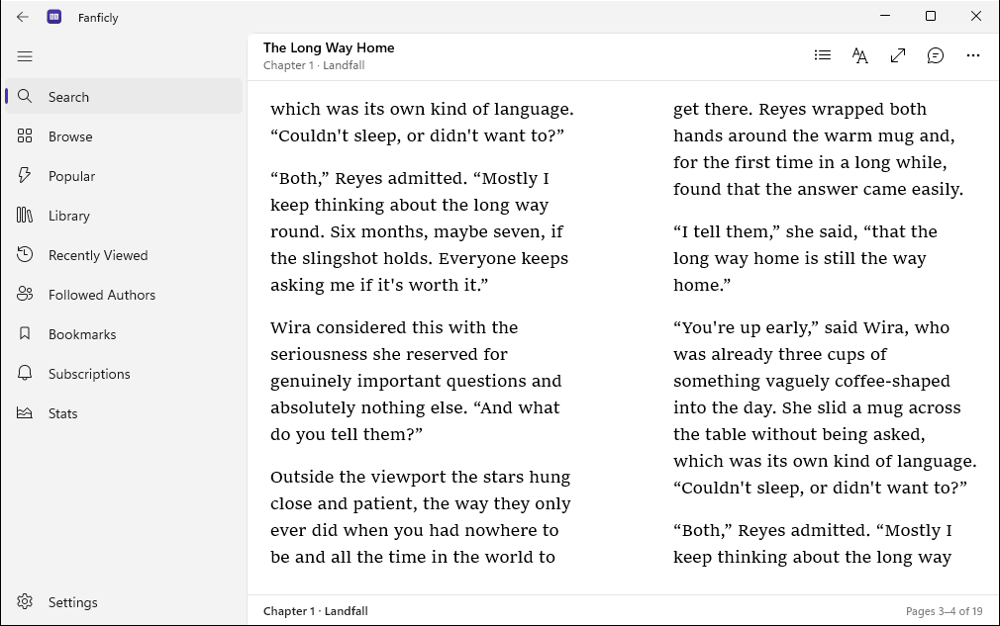

# Fanficly

An open-source, ad-free reader for [Archive of Our Own](https://archiveofourown.org) on iPhone, iPhone Duo, iPad, Mac and Windows. There are no servers, accounts, ads or analytics: everything runs on your device and talks directly to AO3.

[App Store](https://apps.apple.com/app/id6775897153) (iPhone, iPhone Duo, iPad and Mac) · [Microsoft Store](https://apps.microsoft.com/detail/9PH24K7ZCZTX) (Windows) · [fanficly.app](https://fanficly.app)


## What it does

- **Search that does what you typed.** Keywords go to AO3's own search, and live tag suggestions turn words into exact filters with one tap. `teen wolf` means Teen Wolf.
- **A reader made for long stories.** Scroll, swipe by chapter or turn pages like a book, with two-page spreads on wide screens, themes, fonts and named typography profiles.
- **Your library, offline.** Save stories, read them without a connection, sort them into folders, and pick up at the exact paragraph you left.
- **New chapter alerts.** Follow works and authors without an account and get a notification when something new is posted.
- **Listen.** Stories read aloud with the device's own voices, nothing sent anywhere.
- **Stats and a yearly wrap.** Stories finished, time and words read, your streak and your top fandoms, all computed on your device.
- **Optional AO3 account.** Sign in for your AO3 subscriptions, bookmarks and comments. Your password is never stored.

## Pick your platform

Every app has the same features. Open a platform for its screenshots and docs.

<details>
<summary><b>iPhone</b>: the SwiftUI app, iOS 17 and later</summary>
<br>

| Search | Reader | Library | Browse |
| :---: | :---: | :---: | :---: |
|  |  |  |  |

Home-screen widgets, the Safari share sheet, and lock-screen controls while a story is read aloud.

**Docs:** [features and setup](apple/README.md) · [build and run](apple/README.md#development) · [accessibility](apple/ACCESSIBILITY.md) · [roadmap](apple/docs/ROADMAP.md) · [privacy](PRIVACY.md) · [all iPhone screenshots](apple/docs/screenshots/iphone/)

</details>

<details>
<summary><b>iPhone Duo</b>: the same app, folded and unfolded</summary>
<br>

| Folded: search | Folded: reader | Folded: library |
| :---: | :---: | :---: |
|  |  |  |


Unfolded, the reader becomes an open book with the fold as its spine. Folding or unfolding keeps your place in the story.

**Docs:** [features and setup](apple/README.md) · [build and run](apple/README.md#development) · [accessibility](apple/ACCESSIBILITY.md) · [roadmap](apple/docs/ROADMAP.md) · [privacy](PRIVACY.md) · screenshots: [folded](apple/docs/screenshots/duo-outer/), [unfolded](apple/docs/screenshots/duo-inner/)

</details>

<details>
<summary><b>iPad</b>: sidebar layout and Split View</summary>
<br>

| Search | Reader | Library | Browse |
| :---: | :---: | :---: | :---: |
|  |  |  |  |

A sidebar beside every screen, two-page spreads in landscape, and hardware keyboard page turns.

**Docs:** [features and setup](apple/README.md) · [build and run](apple/README.md#development) · [accessibility](apple/ACCESSIBILITY.md) · [roadmap](apple/docs/ROADMAP.md) · [privacy](PRIVACY.md) · [all iPad screenshots](apple/docs/screenshots/ipad/)

</details>

<details>
<summary><b>Mac</b>: the same app through Mac Catalyst</summary>
<br>

| Search | Reader |
| :---: | :---: |
|  |  |

A resizable window, ⌘1–9 for the tabs, interface zoom (⌘+ / ⌘− / ⌘0), and arrow keys to turn pages.

**Docs:** [features and setup](apple/README.md) · [build and run](apple/README.md#development) · [accessibility](apple/ACCESSIBILITY.md) · [roadmap](apple/docs/ROADMAP.md) · [privacy](PRIVACY.md) · [all Mac screenshots](apple/screenshots/final/mac/)

</details>

<details>
<summary><b>Windows</b>: WinUI 3, Windows 10 and 11, x64 and ARM64</summary>
<br>

| Search | Reader |
| :---: | :---: |
|  |  |

Windows 11 widgets and jump lists, sync through OneDrive or any folder you already sync, keyboard, controller and Narrator support. The backup format matches the Apple app, so a PC and an iPhone can share one library.

**Docs:** [features and setup](windows/README.md) · [build and run](windows/README.md#development) · [accessibility](windows/ACCESSIBILITY.md) · [roadmap](windows/ROADMAP.md) · [privacy](windows/PRIVACY.md) · screenshots: [desktop](docs/screenshots/windows/desktop/), [tablet](docs/screenshots/windows/tablet/), [narrow window](docs/screenshots/windows/compact/)

</details>

The screenshots are captured from each app's demo mode and refreshed with every release, so they always show what shipped.

## For developers

| App | Folder | Built with | Developer docs |
| --- | --- | --- | --- |
| iPhone, iPhone Duo, iPad and Mac | [`apple/`](apple/) | SwiftUI, Swift 6 (Mac via Catalyst) | [README](apple/README.md#development) · [contributing](apple/CONTRIBUTING.md) · [releasing](apple/docs/RELEASING.md) |
| Windows | [`windows/`](windows/) | C#, .NET 10, WinUI 3, Native AOT | [README](windows/README.md#development) · [contributing](windows/CONTRIBUTING.md) · [Store](windows/MICROSOFT_STORE.md) |

The two apps share behavior, not code: the Windows app is a port of the Swift app, which stays the reference implementation. Both are developed on `main`.

<details>
<summary>Repository layout</summary>

```text
apple/        the iPhone, iPad and Mac app (Xcode project from project.yml)
windows/      the Windows app (Fanficly.Windows.slnx)
website/      fanficly.app (static site, deployed by Vercel)
docs/         shared pictures (docs/screenshots/windows/)
bin/          repo-wide scripts (roadmap.sh lists both roadmaps)
.github/      CI: ci.yml for apple/, windows-*.yml for windows/; release.yml and
              store-assets.yml release the Apple app (apple/docs/RELEASING.md)
```

CI is split by app: a change under `apple/` runs the Apple workflow, a change under `windows/` runs the Windows ones, and a pull request that touches both runs both.

</details>

## Privacy

We collect nothing. Each store listing links its own policy: [PRIVACY.md](PRIVACY.md) for iPhone, iPad and Mac, and [windows/PRIVACY.md](windows/PRIVACY.md) for Windows.

## Contributing

PRs welcome. Read [CONTRIBUTING.md](CONTRIBUTING.md), then the guide for the app you're changing. Be kind, be patient with reviewers. See [CODE_OF_CONDUCT.md](CODE_OF_CONDUCT.md).

Fanficly is not affiliated with AO3 or the Organization for Transformative Works.

## License

[PolyForm Noncommercial License 1.0.0](LICENSE).
